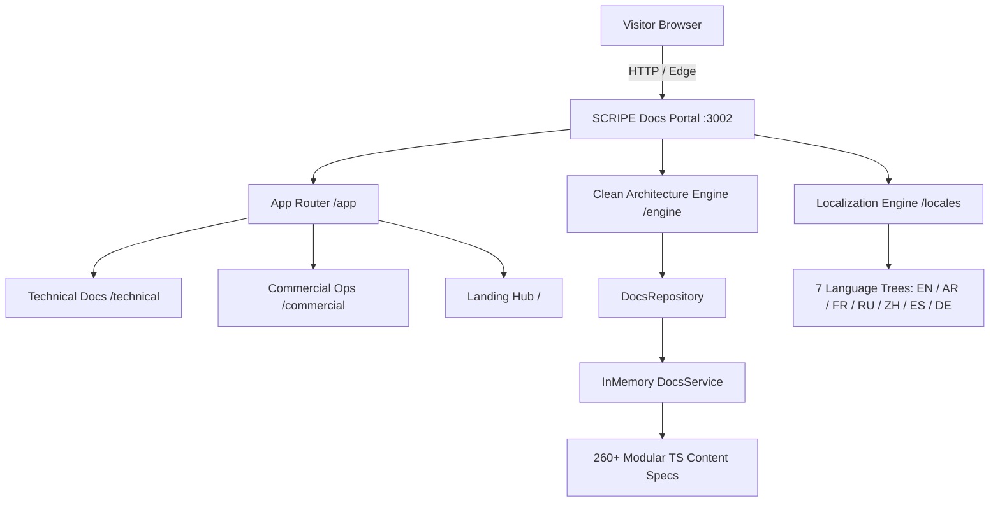

# SCRIPE-Docs-Portal

[](https://github.com/SCRIPE-org/SCRIPE-Docs-Portal/actions/workflows/ci.yml)
[](https://opensource.org/licenses/MIT)
[](https://nextjs.org/)
[](https://react.dev/)
[](https://tailwindcss.com/)
[-c6ff00)](#4-internationalization--7-language-parity)

> High-fidelity, dedicated documentation portal for the **SCRIPE Sports Operations OS** (Venue, Academy, Football Intelligence). Hosted standalone at [`docs.scripe.org`](https://docs.scripe.org) (Local development default port: `3002`).

---

## 1. Architectural Overview

`SCRIPE-Docs-Portal` is an isolated, high-performance documentation platform decoupled from the primary enterprise web application (`SCRIPE-Frontend`). It delivers sub-second navigation, client-side fuzzy search across 260+ guides and schemas, interactive architecture sandboxes, and full 7-language localization.



### Architectural Highlights
- **Framework:** Next.js 16 (App Router) with Turbopack compilation.
- **Port:** Port `3002` (configurable via `PORT` environment variable).
- **Internationalization:** 7 languages (`en`, `ar` with native RTL layout switching, `fr`, `ru`, `zh`, `es`, `de`).
- **Clean Architecture Engine:** Decoupled `DocsRepository`, `DocsService`, `DocPage`, `DocCategory`.
- **Search & Navigation:** Real-time Command Palette (`⌘K` / `Ctrl+K`), sticky TOC scroll-spy, deep link anchors, interactive architecture radar.

---

## 2. Directory Layout

```
SCRIPE-Docs-Portal/
├── .github/
│   └── workflows/
│       └── ci.yml                 # Matrix CI (Node 20 & 22: format, lint, test, build)
├── CODE_OF_CONDUCT.md             # Contributor Covenant v2.1 code of conduct
├── CONTRIBUTING.md                # Local setup, conventions, PR process
├── LICENSE                        # MIT License
├── README.md                      # Architecture, setup, and deployment documentation
├── SECURITY.md                    # Coordinated vulnerability disclosure policy
├── package.json                   # Dependencies, build & test scripts
├── tsconfig.json                  # TypeScript compiler options and path aliases
├── next.config.ts                 # Turbopack, headers, and build optimization
├── tailwind.config.ts             # SCRIPE Signal Lime design tokens
├── public/
│   ├── brand/                     # Official brand logos, favicons, vector marks
│   └── docs/                      # Screenshots, media, and architectural diagrams
└── src/
    ├── app/
    │   ├── globals.css            # Atmospheric glows, tokens, prose styles
    │   ├── layout.tsx             # Root layout with ThemeProvider + DocsI18nProvider
    │   ├── page.tsx               # Cinematic Developer Landing Hub
    │   ├── technical/             # Technical docs routing (/technical/[...slug])
    │   └── commercial/            # Commercial ops routing (/commercial/[...slug])
    ├── components/
    │   ├── landing/               # ArchitectureRadar and InteractiveCliPreview
    │   └── ui/                    # Reusable atomic UI components
    ├── data/content/              # 260+ modular TypeScript documentation specifications
    ├── engine/                    # Clean Architecture engine, mappers, and layout views
    └── locales/                   # 7-language registry trees with strict parity
```

---

## 3. Quickstart & Development Commands

### Running Locally with pnpm
```powershell
# 1. Install dependencies
pnpm install --frozen-lockfile

# 2. Start local development server (http://localhost:3002)
pnpm run dev

# 3. Run validation tests
pnpm run test

# 4. Check code formatting & lint
pnpm run lint
pnpm exec prettier --check src/

# 5. Compile production build
pnpm run build
```

### Running via SCRIPE Monorepo CLI
From the root of the SCRIPE repository:
```powershell
# Start Docs Portal dev server
node SCRIPE-Dev-Tools/scripe.js dev docs

# Start full monorepo stack (Backend + Frontend + Docs)
node SCRIPE-Dev-Tools/scripe.js dev all

# Compile Docs Portal production build
node SCRIPE-Dev-Tools/scripe.js build docs

# Run all quality checks across the repository
node SCRIPE-Dev-Tools/scripe.js check
```

---

## 4. Standalone Deployment Instructions

`SCRIPE-Docs-Portal` is completely decoupled and can be deployed to any modern cloud infrastructure.

### A. Vercel (Recommended)
1. Import repository `SCRIPE-Docs-Portal` in the Vercel dashboard.
2. Framework Preset: **Next.js**.
3. Build Command: `pnpm run build`.
4. Output Directory: `.next`.
5. Install Command: `pnpm install`.
6. Environment Variables:
   - `NEXT_PUBLIC_APP_URL=https://docs.scripe.org`

### B. Cloudflare Pages
Deploy using the `@cloudflare/next-on-pages` adapter or OpenNext:
```bash
# Build with static export or Cloudflare worker runtime
pnpm exec @cloudflare/next-on-pages
```

### C. Docker Deployment
Create a production container image using the multi-stage Dockerfile pattern:

```dockerfile
# Stage 1: Dependencies
FROM node:22-alpine AS deps
RUN corepack enable && corepack prepare pnpm@9.15.4 --activate
WORKDIR /app
COPY package.json pnpm-lock.yaml ./
RUN pnpm install --frozen-lockfile

# Stage 2: Builder
FROM node:22-alpine AS builder
RUN corepack enable && corepack prepare pnpm@9.15.4 --activate
WORKDIR /app
COPY --from=deps /app/node_modules ./node_modules
COPY . .
ENV NEXT_TELEMETRY_DISABLED=1
RUN pnpm run build

# Stage 3: Runner
FROM node:22-alpine AS runner
WORKDIR /app
ENV NODE_ENV=production
ENV PORT=3002
COPY --from=builder /app/public ./public
COPY --from=builder /app/.next/standalone ./
COPY --from=builder /app/.next/static ./.next/static

EXPOSE 3002
CMD ["node", "server.js"]
```

---

## 5. Environment Variables

| Variable | Default | Purpose |
|:---|:---:|:---|
| `PORT` | `3002` | Local dev and production server HTTP listener port |
| `NODE_ENV` | `development` | Target runtime environment (`development` \| `production`) |
| `NEXT_PUBLIC_APP_URL` | `http://localhost:3002` | Public canonical base URL for metadata and OpenGraph |
| `NEXT_TELEMETRY_DISABLED` | `1` | Suppresses Next.js anonymous build telemetry |

---

## 6. Documentation Synchronization Pipeline

`SCRIPE-Dev-Tools` continuously reads TypeScript source definitions from `SCRIPE-Docs-Portal/src/data/content` and generates markdown files into root `/docs/`:

```powershell
node SCRIPE-Dev-Tools/scripe.js docs sync
```

---

## 7. Security & Code of Conduct

- **Security Policy:** See [SECURITY.md](./SECURITY.md) for vulnerability disclosure protocols.
- **Code of Conduct:** See [CODE_OF_CONDUCT.md](./CODE_OF_CONDUCT.md) for community standards.
- **Contributing Guidelines:** See [CONTRIBUTING.md](./CONTRIBUTING.md) for guidelines on opening PRs.
- **License:** Distributed under the [MIT License](./LICENSE).
