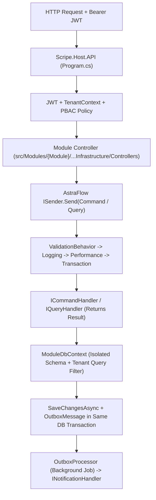

# SCRIPE-Backend — Super Onboarding Bible (/understand-onboard)

> **Role-Tailored Engineering Onboarding Guide** covering all **18 Backend Modules**, **Core Kernel**, **Host.API**, **AstraFlow 2.2.0**, and **Dual-Mode Multi-DB Persistence**.

---

## 1. Day-1 Mental Model: How SCRIPE-Backend Works

### The 5 Golden Laws of SCRIPE-Backend
1. **3-Project Module Isolation**: Every module in `src/Modules/{Module}/` has strictly three projects:
   - `Scripe.Module.{Module}.Domain` — Entities (`AuditableEntity`), Value Objects, Domain Events (`INotification`), Specifications. Zero infrastructure dependencies.
   - `Scripe.Module.{Module}.Application` — Commands (`ICommand<T>`), Queries (`IQuery<T>`), Handlers, Validators (`AbstractValidator<T>`), DTOs, `[AstraGenerateMapping]` static partial mappers, Permission/Feature/Menu providers.
   - `Scripe.Module.{Module}.Infrastructure` — `{Module}DbContext`, `IEntityTypeConfiguration<T>`, Controllers, Seeders (`IModuleSeeder`, `IModuleDevDataSeeder`), Background Jobs (`IAutoRegisteredJob`).
2. **Result<T> Pattern Everywhere**: Never throw exceptions for business or validation errors. Always return `Result.Success(value)` or `Result.Failure<T>(Error)`.
3. **AstraFlow 2.2.0 Ecosystem Lock**: All CQRS dispatch uses `AstraFlow.Mediator` & `AstraFlow.Contracts`. All compile-time mappings use `[AstraGenerateMapping]`.
4. **Zero Cross-Module Physical Foreign Keys**: Never reference another module's Domain entity in EF Core navigation properties. Use `Guid` logical IDs + `Scripe.Core.Contracts` synchronous interfaces or asynchronous Outbox domain events.
5. **Dual-Mode Multi-Database Agnosticism**: Every module owns its schema (`identity`, `venue`, `crm`, `academy`, `billing`, etc.) and supports SQL Server, PostgreSQL, and Oracle via `scripe db` CLI.

---

## 2. Where to Find Everything in Each Module

| Module | Schema | Where Controllers Live | Where CQRS Handlers Live | Where DbContext Lives |
|---|---|---|---|---|
| **Identity** | `identity` | `src/Host/API/Controllers/` & `src/Modules/Identity/` (0 ctrls / **0 endpoints**) | `src/Modules/Identity/Identity.Application/` (284 handlers) | `src/Modules/Identity/Identity.Infrastructure/` (IdentityDbContext, SqlServerIdentityDbContext, OracleIdentityDbContext, PostgreSqlIdentityDbContext, SqlitePartyKernelDbContext) |
| **Entitlements** | `entitlements` | `src/Host/API/Controllers/` & `src/Modules/Entitlements/` (0 ctrls / **0 endpoints**) | `src/Modules/Entitlements/Entitlements.Application/` (184 handlers) | `src/Modules/Entitlements/Entitlements.Infrastructure/` (EntitlementsDbContext, SqlServerEntitlementsDbContext, OracleEntitlementsDbContext, PostgreSqlEntitlementsDbContext) |
| **CustomFields** | `custom_fields` | `src/Host/API/Controllers/` & `src/Modules/CustomFields/` (0 ctrls / **0 endpoints**) | `src/Modules/CustomFields/CustomFields.Application/` (74 handlers) | `src/Modules/CustomFields/CustomFields.Infrastructure/` (CustomFieldsDbContext, SqlServerCustomFieldsDbContext, OracleCustomFieldsDbContext, PostgreSqlCustomFieldsDbContext) |
| **Venue** | `venue` | `src/Host/API/Controllers/` & `src/Modules/Venue/` (0 ctrls / **0 endpoints**) | `src/Modules/Venue/Venue.Application/` (60 handlers) | `src/Modules/Venue/Venue.Infrastructure/` (VenueDbContext, SqlServerVenueDbContext, OracleVenueDbContext, PostgreSqlVenueDbContext, AuditDeliveryDbContext, TestSqliteVenueDbContext) |
| **CRM** | `crm` | `src/Host/API/Controllers/` & `src/Modules/CRM/` (0 ctrls / **0 endpoints**) | `src/Modules/CRM/CRM.Application/` (64 handlers) | `src/Modules/CRM/CRM.Infrastructure/` (CRMDbContext, OracleCRMDbContext, PostgreSqlCRMDbContext, SqlServerCRMDbContext) |
| **PartyKernel** | `party_kernel` | `src/Host/API/Controllers/` & `src/Modules/PartyKernel/` (0 ctrls / **0 endpoints**) | `src/Modules/PartyKernel/PartyKernel.Application/` (43 handlers) | `src/Modules/PartyKernel/PartyKernel.Infrastructure/` (PartyKernelDbContext, SqlServerPartyKernelDbContext, OraclePartyKernelDbContext, PostgreSqlPartyKernelDbContext, PartyKernelSqliteDbContext, SqlitePartyKernelDbContext, SqlitePartyKernelDbContext, SqlitePartyKernelDbContext, AuditProbeDbContext) |
| **Hrms** | `hrms` | `src/Host/API/Controllers/` & `src/Modules/Hrms/` (0 ctrls / **0 endpoints**) | `src/Modules/Hrms/Hrms.Application/` (35 handlers) | `src/Modules/Hrms/Hrms.Infrastructure/` (HrmsDbContext, SqlServerHrmsDbContext, OracleHrmsDbContext, PostgreSqlHrmsDbContext) |
| **OrganizationCore** | `organization_core` | `src/Host/API/Controllers/` & `src/Modules/OrganizationCore/` (0 ctrls / **0 endpoints**) | `src/Modules/OrganizationCore/OrganizationCore.Application/` (31 handlers) | `src/Modules/OrganizationCore/OrganizationCore.Infrastructure/` (OrganizationCoreDbContext, SqlServerOrganizationCoreDbContext, OracleOrganizationCoreDbContext, PostgreSqlOrganizationCoreDbContext) |
| **Compliance** | `compliance` | `src/Host/API/Controllers/` & `src/Modules/Compliance/` (0 ctrls / **0 endpoints**) | `src/Modules/Compliance/Compliance.Application/` (32 handlers) | `src/Modules/Compliance/Compliance.Infrastructure/` (ComplianceDbContext, SqlServerComplianceDbContext, OracleComplianceDbContext, PostgreSqlComplianceDbContext, TestComplianceDbContext) |
| **CatalogPricing** | `catalog_pricing` | `src/Host/API/Controllers/` & `src/Modules/CatalogPricing/` (0 ctrls / **0 endpoints**) | `src/Modules/CatalogPricing/CatalogPricing.Application/` (6 handlers) | `src/Modules/CatalogPricing/CatalogPricing.Infrastructure/` (CatalogPricingDbContext, SqlServerCatalogPricingDbContext, OracleCatalogPricingDbContext, PostgreSqlCatalogPricingDbContext) |
| **Marketplace** | `marketplace` | `src/Host/API/Controllers/` & `src/Modules/Marketplace/` (0 ctrls / **0 endpoints**) | `src/Modules/Marketplace/Marketplace.Application/` (37 handlers) | `src/Modules/Marketplace/Marketplace.Infrastructure/` (MarketplaceDbContext, SqlServerMarketplaceDbContext, OracleMarketplaceDbContext, PostgreSqlMarketplaceDbContext) |
| **Plugins** | `plugins` | `src/Host/API/Controllers/` & `src/Modules/Plugins/` (0 ctrls / **0 endpoints**) | `src/Modules/Plugins/Plugins.Application/` (25 handlers) | `src/Modules/Plugins/Plugins.Infrastructure/` (PluginsDbContext, SqlServerPluginsDbContext, OraclePluginsDbContext, PostgreSqlPluginsDbContext) |
| **Integrations** | `integrations` | `src/Host/API/Controllers/` & `src/Modules/Integrations/` (0 ctrls / **0 endpoints**) | `src/Modules/Integrations/Integrations.Application/` (15 handlers) | `src/Modules/Integrations/Integrations.Infrastructure/` (IntegrationsDbContext, SqlServerIntegrationsDbContext, OracleIntegrationsDbContext, PostgreSqlIntegrationsDbContext) |
| **Media** | `media` | `src/Host/API/Controllers/` & `src/Modules/Media/` (0 ctrls / **0 endpoints**) | `src/Modules/Media/Media.Application/` (9 handlers) | `src/Modules/Media/Media.Infrastructure/` (MediaDbContext, SqlServerMediaDbContext, OracleMediaDbContext, PostgreSqlMediaDbContext) |
| **Communication** | `communication` | `src/Host/API/Controllers/` & `src/Modules/Communication/` (0 ctrls / **0 endpoints**) | `src/Modules/Communication/Communication.Application/` (4 handlers) | `src/Modules/Communication/Communication.Infrastructure/` (CommunicationDbContext, SqlServerCommunicationDbContext, OracleCommunicationDbContext, PostgreSqlCommunicationDbContext) |
| **Finance** | `finance` | `src/Host/API/Controllers/` & `src/Modules/Finance/` (0 ctrls / **0 endpoints**) | `src/Modules/Finance/Finance.Application/` (15 handlers) | `src/Modules/Finance/Finance.Infrastructure/` (FinanceDbContext, SqlServerFinanceDbContext, OracleFinanceDbContext, PostgreSqlFinanceDbContext, LegacySchemaFinanceDbContext, TestFinanceDbContext) |
| **WorkManagement** | `work_management` | `src/Host/API/Controllers/` & `src/Modules/WorkManagement/` (0 ctrls / **0 endpoints**) | `src/Modules/WorkManagement/WorkManagement.Application/` (5 handlers) | `src/Modules/WorkManagement/WorkManagement.Infrastructure/` (SqlServerWorkManagementDbContext, OracleWorkManagementDbContext, PostgreSqlWorkManagementDbContext, WorkManagementDbContext) |
| **Analytics** | `analytics` | `src/Host/API/Controllers/` & `src/Modules/Analytics/` (0 ctrls / **0 endpoints**) | `src/Modules/Analytics/Analytics.Application/` (3 handlers) | `src/Modules/Analytics/Analytics.Infrastructure/` (AnalyticsDbContext, SqlServerAnalyticsDbContext, OracleAnalyticsDbContext, PostgreSqlAnalyticsDbContext) |

---

## 3. Step-by-Step Playbooks for Common Backend Tasks

### Playbook A: Adding a New Feature / Endpoint to an Existing Module
1. **Domain Layer**: Add or update entity in `Scripe.Module.{Mod}.Domain/Entities/` inheriting from `AuditableEntity`. Ensure all timestamps use `DateTime.UtcNow`.
2. **Application Layer**:
   - Create `{Action}{Entity}Command.cs` implementing `ICommand<{Entity}Response>`.
   - Create `{Action}{Entity}CommandValidator.cs` inheriting `AbstractValidator<{Action}{Entity}Command>`.
   - Create `{Action}{Entity}CommandHandler.cs` implementing `ICommandHandler<{Action}{Entity}Command, {Entity}Response>` returning `Result<{Entity}Response>`.
   - Add compile-time mapper in `{Entity}Maps.cs` with `[AstraGenerateMapping]`.
3. **Infrastructure Layer**:
   - Add `DbSet<{Entity}>` to `{Mod}DbContext.cs` and `{Entity}Configuration.cs` in `Persistence/Configurations/`.
   - Expose endpoint in `Controllers/{Entity}Controller.cs` with `[PermissionRequired(...)]`.
4. **UAT & Seeding Readiness**:
   - Register permissions in `{Mod}PermissionProvider.cs`, features/quotas in `{Mod}FeatureProvider.cs`, menus in `{Mod}MenuProvider.cs`, and seed data in `{Mod}DevDataSeeder.cs`.
5. **Verification**:
   - Run `scripe build backend`, `scripe arch-check`, and `scripe test`.
