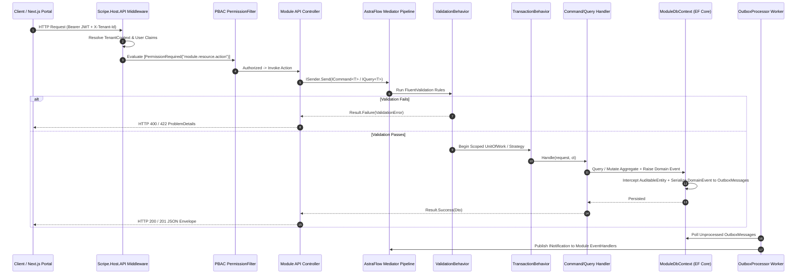

# SCRIPE-Backend — Deep-Dive Architectural & Codebase Explanation (/understand-explain)

> **Exhaustive Deep-Dive Reference** across the `Scripe.Host.API` pipeline, `Scripe.Core` kernel abstractions, **AstraFlow 2.2.0** mediator/generator mechanics, **Dual-Mode Persistence**, **Transactional Outbox/Inbox**, and **5-Layer Security**.

---

## 1. Request-to-Database Execution Trace

---

## 2. Core Kernel Architecture (`src/Core/Scripe.Core`)

- **Total Files**: `256` | **Lines of Code**: `0`
- **Base Entities**:
  - `BaseEntity`: Provides `Guid Id` and domain event collection (`DomainEvents`, `AddDomainEvent`, `ClearDomainEvents`).
  - `AuditableEntity`: Adds `TenantId`, `CreatedAt`, `CreatedBy`, `UpdatedAt`, `UpdatedBy`, `IsDeleted`, `DeletedAt`, `DeletedBy`, and concurrency token `RowVersion`.
- **Result<T> Monad & Error Taxonomy**:
  - Every command/query returns `Result<T>` or `Result`.
  - Standardized error factory methods: `Error.Validation`, `Error.NotFound`, `Error.Conflict`, `Error.Forbidden`, `Error.Unauthorized`, `Error.QuotaExceeded`.
- **Cross-Module Contracts (`Scripe.Core/Contracts`)**:
  - ``

---

## 3. AstraFlow 2.2.0 In-House Framework Mechanics

1. **`AstraFlow.Contracts` & `AstraFlow.Mediator`**:
   - `907` Command Handlers (`ICommandHandler<TCommand, TResponse>`)
   - `885` Query Handlers (`IQueryHandler<TQuery, TResponse>`)
   - `28` Domain Event Notification Handlers (`INotificationHandler<TEvent>`)
2. **`AstraFlow.Generators` (`[AstraGenerateMapping]`)**:
   - Roslyn incremental source generator emitting zero-allocation static partial extension methods (`ToDto`, `ToListDto`) at compile time without reflection.
3. **Pipeline Behaviors**:
   - `UnhandledExceptionBehavior` -> `LoggingBehavior` -> `PerformanceBehavior` -> `ValidationBehavior` -> `TransactionBehavior`.

---

## 4. Dual-Mode Multi-Database & Schema Isolation

Every module registers its own `DbContext` with an explicit default schema (`modelBuilder.HasDefaultSchema("{schema}")`):

| Module | Schema | DbContext | DbSets (Tables) | Migrations | Seeders |
|---|---|---|---|---|---|
| **Entitlements** | `entitlements` | `EntitlementsDbContext`, `SqlServerEntitlementsDbContext`, `OracleEntitlementsDbContext`, `PostgreSqlEntitlementsDbContext` | 49 | 0 | 9 |
| **Identity** | `identity` | `IdentityDbContext`, `SqlServerIdentityDbContext`, `OracleIdentityDbContext`, `PostgreSqlIdentityDbContext`, `SqlitePartyKernelDbContext` | 46 | 0 | 10 |
| **CustomFields** | `custom_fields` | `CustomFieldsDbContext`, `SqlServerCustomFieldsDbContext`, `OracleCustomFieldsDbContext`, `PostgreSqlCustomFieldsDbContext` | 17 | 0 | 3 |
| **Venue** | `venue` | `VenueDbContext`, `SqlServerVenueDbContext`, `OracleVenueDbContext`, `PostgreSqlVenueDbContext`, `AuditDeliveryDbContext`, `TestSqliteVenueDbContext` | 17 | 0 | 2 |
| **CRM** | `crm` | `CRMDbContext`, `OracleCRMDbContext`, `PostgreSqlCRMDbContext`, `SqlServerCRMDbContext` | 16 | 0 | 9 |
| **CatalogPricing** | `catalog_pricing` | `CatalogPricingDbContext`, `SqlServerCatalogPricingDbContext`, `OracleCatalogPricingDbContext`, `PostgreSqlCatalogPricingDbContext` | 15 | 0 | 2 |
| **Marketplace** | `marketplace` | `MarketplaceDbContext`, `SqlServerMarketplaceDbContext`, `OracleMarketplaceDbContext`, `PostgreSqlMarketplaceDbContext` | 14 | 0 | 4 |
| **PartyKernel** | `party_kernel` | `PartyKernelDbContext`, `SqlServerPartyKernelDbContext`, `OraclePartyKernelDbContext`, `PostgreSqlPartyKernelDbContext`, `PartyKernelSqliteDbContext`, `SqlitePartyKernelDbContext`, `SqlitePartyKernelDbContext`, `SqlitePartyKernelDbContext`, `AuditProbeDbContext` | 12 | 0 | 2 |
| **Compliance** | `compliance` | `ComplianceDbContext`, `SqlServerComplianceDbContext`, `OracleComplianceDbContext`, `PostgreSqlComplianceDbContext`, `TestComplianceDbContext` | 11 | 0 | 6 |
| **Plugins** | `plugins` | `PluginsDbContext`, `SqlServerPluginsDbContext`, `OraclePluginsDbContext`, `PostgreSqlPluginsDbContext` | 8 | 0 | 2 |
| **Finance** | `finance` | `FinanceDbContext`, `SqlServerFinanceDbContext`, `OracleFinanceDbContext`, `PostgreSqlFinanceDbContext`, `LegacySchemaFinanceDbContext`, `TestFinanceDbContext` | 7 | 0 | 2 |
| **Hrms** | `hrms` | `HrmsDbContext`, `SqlServerHrmsDbContext`, `OracleHrmsDbContext`, `PostgreSqlHrmsDbContext` | 7 | 0 | 2 |
| **Integrations** | `integrations` | `IntegrationsDbContext`, `SqlServerIntegrationsDbContext`, `OracleIntegrationsDbContext`, `PostgreSqlIntegrationsDbContext` | 7 | 0 | 2 |
| **OrganizationCore** | `organization_core` | `OrganizationCoreDbContext`, `SqlServerOrganizationCoreDbContext`, `OracleOrganizationCoreDbContext`, `PostgreSqlOrganizationCoreDbContext` | 7 | 0 | 2 |
| **Communication** | `communication` | `CommunicationDbContext`, `SqlServerCommunicationDbContext`, `OracleCommunicationDbContext`, `PostgreSqlCommunicationDbContext` | 6 | 0 | 3 |
| **Media** | `media` | `MediaDbContext`, `SqlServerMediaDbContext`, `OracleMediaDbContext`, `PostgreSqlMediaDbContext` | 4 | 0 | 2 |
| **Analytics** | `analytics` | `AnalyticsDbContext`, `SqlServerAnalyticsDbContext`, `OracleAnalyticsDbContext`, `PostgreSqlAnalyticsDbContext` | 2 | 0 | 2 |
| **WorkManagement** | `work_management` | `SqlServerWorkManagementDbContext`, `OracleWorkManagementDbContext`, `PostgreSqlWorkManagementDbContext`, `WorkManagementDbContext` | 1 | 0 | 2 |
